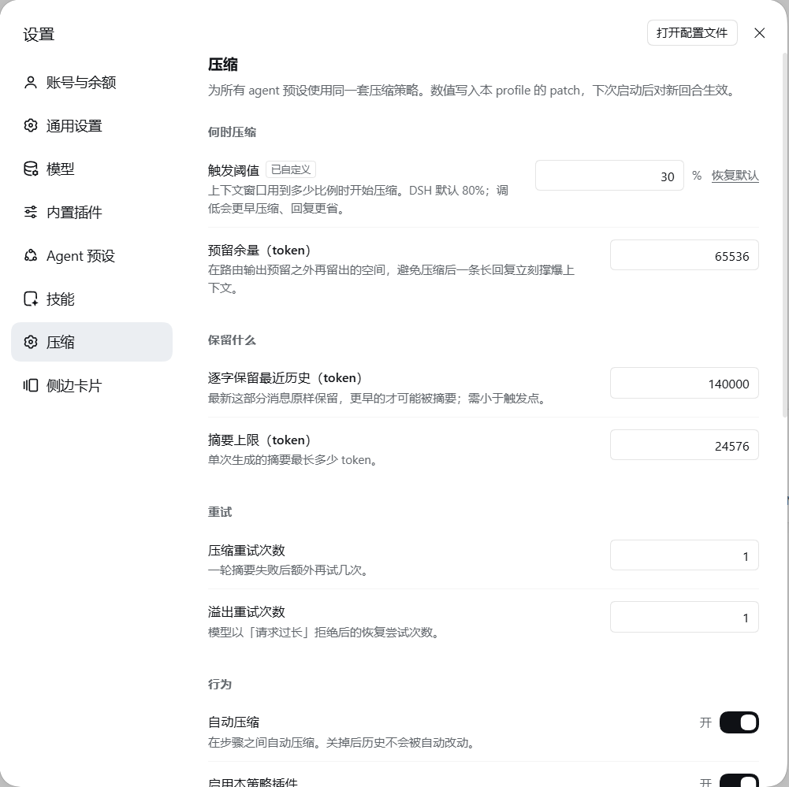

# dsh-compaction-policy

[简体中文](README.md) | English

One compaction policy for every DSH agent preset, kept correct across DSH upgrades — and editable from the Web UI.

## Preview



## Why this exists

`@deepseek-ai/dsh-web-app` disables the host-plane compaction trio
(`compaction-basic`, `command-compact`, `tool-result-pruner`) with
`- id: compaction-basic / disabled: true`. The instance an Agent actually uses is
the one inside its preset (`standard`, `ptc`, `minimal`, `cordis`).

A Loader patch replaces the targeted row's **whole** `config`, so applying a
policy to a preset means restating its complete plugin list. Restated lists go
stale silently: DSH ships a new tool, renames a package, or reorders plugins and
the override keeps the old tree — no error, just missing capabilities.

## What it does

On every start the plugin regenerates one marked region of the profile patch
(`$DSH_HOME/profiles/<profile>/cordis.patch.yml`):

```
# >>> dsh-compaction-policy — managed block, regenerated on start; edit nothing inside
- id: preset-standard
  ...
# <<< dsh-compaction-policy
```

Each entry is produced from the preset file of the **installed** DSH
(`@deepseek-ai/dsh-web-app/presets/<id>.patch.yml`, read from `app.asar` when
packaged). The transformation is textual: the shipped `- insert:` wrapper is
removed, the list is dedented, and a `config` is added to the existing
`compaction-basic` entry. Everything else — `!!js` conditions, nested groups,
plan-mode prompts, future plugins — passes through byte-for-byte.

Writes are applied by the **next** start, never in a running turn, so a bad
regenerate cannot destabilize a live session.

## Settings page

**Settings → 压缩 / Compaction** renders every parameter with its own control,
its default, and a per-field reset:

| Field | Default | Meaning |
|---|---|---|
| `thresholdRatio` | `38 %` | Share of the context window that triggers compaction (stock DSH: 80 %) |
| `headroomTokens` | `65536` | Safety headroom beyond the routed output reservation |
| `retainTokens` | `140000` | Recent history kept verbatim (never combined with `retainRatio`) |
| `maxTokens` | `24576` | Summary output cap |
| `compactionRetries` | `1` | Extra compaction attempts |
| `maxOverflowRetries` | `1` | Recovery retries after a context overflow |
| `auto` | `true` | Automatic compaction |
| `enabled` | `true` | While off, this plugin leaves the patch untouched |
| `presets` | `standard, ptc, minimal, cordis` | Presets to cover |
| `summarizationProvider` + `summarizationModel` | empty (the session's route) | Route that writes the summary; set together or not at all |
| `summarization.reasoningEffort` | `high` | Thinking level sent with the summary call only (`inherit` sends none) |

Trigger: `T = floor(min(W × ratio, W − O − headroom))` per route.

The thinking level is the one setting that is not a `compaction-basic` field:
DSH has no config key for it, so the plugin applies it through the `llm/stream`
waterfall and touches only calls that declare `purpose: 'compaction'` — your own
turns and every other request through the same provider keep whatever they
asked for. Stock DSH sends no effort there, so a summary used to run at whatever
the provider defaulted to; a provider default the model does not declare made
every `/compact` fail with `does not support reasoning effort "…"` while the
chat picker kept working. Two independent levers now cover that: this level, and
the summary route above. If the level you pick is not declared by the model that
writes the summary, the compaction error names both; pick another level, point
the route at a model that declares it, or choose `inherit`.

The page reads and writes `GET`/`POST /compaction-policy/config` on the Host
half. A save validates every field, writes
`$DSH_HOME/profiles/<profile>/compaction-policy.json`, and immediately
regenerates the managed region, so the page can report which presets were
updated. Only values that differ from the defaults are stored: clearing a field
to its default **removes** it, so an untouched parameter keeps following future
DSH numbers instead of freezing today's.

The policy is resolved from three layers, weakest first:

1. the defaults in this package,
2. `compaction-policy.json`, written only by this page,
3. an explicit `config.policy` in the profile patch — the hand-written escape
   hatch. Such a field wins, and the page marks it **pinned by profile YAML**
   instead of silently ignoring an edit.

The summary thinking level follows the same three layers, with
`config.summarization.reasoningEffort` as its pin.

The route is not public: it asks Connection for the same Host/Origin fence and
browser-credential verdict as the rest of the Web surface (`requestRejection`),
so only an authenticated page of this deployment can read or write it.

The region regenerates again on every start, so the file remains the single
source for both the page and the boot-time rewrite.

## Configuration file

The page writes `compaction-policy.json`; the profile patch keeps its normal
row form for anyone who wants to pin a value or switch the plugin off in YAML:

```yaml
- id: compaction-policy
  name: 'dsh-compaction-policy'
  config:
    enabled: true                                  # false leaves the patch untouched
    presets: [standard, ptc, minimal, cordis]      # subset to cover fewer presets
    policy:
      thresholdRatio: 0.38                         # a pinned field; the page shows it locked
    summarization:
      reasoningEffort: medium                      # also pinnable; `''` means "send none"
```

The JSON document the page owns:

```json
{
  "version": 1,
  "policy": { "thresholdRatio": 0.5 },
  "enabled": false,
  "presets": ["standard", "ptc"],
  "summarization": { "reasoningEffort": "low" },
  "lastRun": { "at": "...", "applied": ["standard"], "skipped": [], "written": true }
}
```

`lastRun` is bookkeeping for the page's coverage summary; editing or deleting it
is harmless.

## Install

Install the tagged release from GitHub into the desktop profile:

```bash
dsh plugin --profile desktop add github:wutong233/dsh-compaction-policy#v1.2.0
```

Restart DeepSeek Harness after installation. For another profile, replace
`desktop` with its name. The plugin command adds the bundle to the profile;
check that `dsh-compaction-policy` appears in `dsh.profile.bundles` in the
profile's `package.json` if it does not load.

This project is an independent plugin and is not affiliated with DeepSeek.

## Verify

```bash
# regenerate + report without booting DSH (Electron runtime needed for app.asar)
"<DeepSeek Harness.exe>" --input-type=module \
  -e "import('dsh-compaction-policy').then(m => m.sync({ patchPath: '<profile>/cordis.patch.yml' }))"

curl -s http://127.0.0.1:<port>/compaction-policy/config   # settings page payload
```

A second `sync` returns `{ changed: false }`; that is the idempotence check.

## Known limits

- One start behind: an upgrade that changes a preset is picked up on the start
  after the upgrade, not during it.
- Requires a writable profile patch; a read-only profile logs and does nothing.
- The region is owned: hand edits inside the markers are replaced on next start.
- The settings page exists only in the Web profile (it needs `webServer`); a
  headless profile keeps the regeneration and drops the routes.
- The thinking level reaches `purpose: 'compaction'` calls only. DSH freezes a
  request it wants immutable, and a frozen one keeps no level; DSH's own
  summaries are not frozen, so this applies in practice.
- The page's JSON file is per profile, so two profiles can hold different
  policies while sharing one installation.

## License

[MIT](LICENSE)

