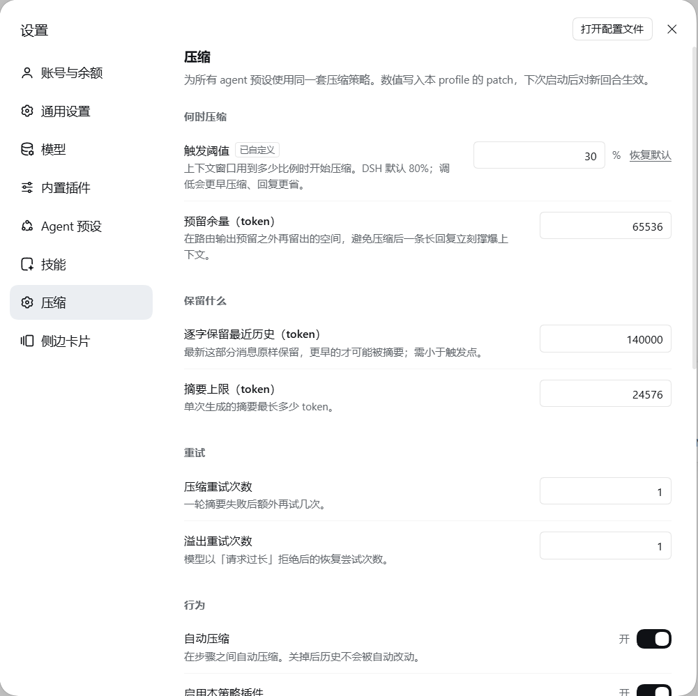

# DSH上下文压缩管理

`dsh-compaction-policy`

简体中文 | [English](README.en.md)

为 DeepSeek Harness（DSH）的所有智能体预设统一配置上下文压缩策略，并在 DSH 升级后根据已安装版本的预设自动更新。支持在 Web 界面中调整设置。

## 效果展示



## 安装

从 GitHub 的版本标签安装到 desktop 配置：

```bash
dsh plugin --profile desktop add github:wutong233/dsh-compaction-policy#v1.2.0
```

安装后重启 DeepSeek Harness。其他配置请将 `desktop` 替换为对应名称。如果插件没有加载，请检查配置目录的 `package.json` 中，`dsh.profile.bundles` 是否包含 `dsh-compaction-policy`。

本项目是独立插件，与 DeepSeek 无官方关联。

## 工作原理

DSH Web 应用会禁用宿主层的压缩插件，智能体实际使用的是各自预设（`standard`、`ptc`、`minimal`、`cordis`）中的实例。Loader 补丁会替换目标项的整个 `config`；如果手动复制完整的插件列表，DSH 升级后该列表可能悄然过时，导致新工具或其他功能缺失。

本插件每次启动时，从**当前安装的 DSH** 读取各预设文件，并重新生成配置补丁 `$DSH_HOME/profiles/<profile>/cordis.patch.yml` 中的托管区域：

```yaml
# >>> dsh-compaction-policy — managed block, regenerated on start; edit nothing inside
- id: preset-standard
  # ...
# <<< dsh-compaction-policy
```

它通过文本转换移除原始 `- insert:` 包装、调整缩进，并为现有 `compaction-basic` 项添加配置；`!!js` 条件、嵌套分组、计划模式提示词和其他插件内容保持不变。写入的补丁在**下次启动**时生效，不会在运行中的对话中途更改插件树。

## 设置页面

在 **设置 → 压缩** 中，可以调整各参数、查看默认值并单独重置：

| 参数 | 默认值 | 说明 |
|---|---|---|
| `thresholdRatio` | `38%` | 触发压缩的上下文窗口比例（DSH 原始默认值为 80%） |
| `headroomTokens` | `65536` | 在路由输出预留之外额外保留的 token 数 |
| `retainTokens` | `140000` | 逐字保留的最近历史 token 数；不与 `retainRatio` 同时使用 |
| `maxTokens` | `24576` | 摘要输出的 token 上限 |
| `compactionRetries` | `1` | 额外压缩重试次数 |
| `maxOverflowRetries` | `1` | 上下文溢出后的恢复重试次数 |
| `auto` | `true` | 是否自动压缩 |
| `enabled` | `true` | 关闭后插件不再修改补丁 |
| `presets` | `standard, ptc, minimal, cordis` | 应用策略的预设 |
| `summarizationProvider` + `summarizationModel` | 空（使用会话路由） | 生成摘要的路由；两项需同时设置或同时留空 |
| `summarization.reasoningEffort` | `high` | 仅用于摘要调用的思考强度；选择 `inherit` 时不发送该参数 |

每条路由的触发阈值为 `T = floor(min(W × ratio, W − O − headroom))`。

摘要思考强度不是 `compaction-basic` 字段：插件通过 `llm/stream` 钩子仅修改标记为 `purpose: 'compaction'` 的调用，其他请求保留原有设置。如果摘要模型不支持所选强度，压缩错误会指出模型和强度；可以换一个强度、指定支持该强度的摘要路由，或选择 `inherit`。

设置页面通过宿主端的 `GET`/`POST /compaction-policy/config` 读取和保存。保存时会校验字段、写入 `$DSH_HOME/profiles/<profile>/compaction-policy.json`，并立即重新生成托管区域，供下次启动使用。只保存不同于默认值的设置；重置字段会从文件中移除它。

配置按以下顺序覆盖，后者优先：

1. 插件内置默认值；
2. 设置页面写入的 `compaction-policy.json`；
3. 配置补丁中显式指定的 `config.policy`。被 YAML 固定的字段会在页面中标明。

摘要思考强度也遵循相同优先级，其 YAML 固定项为 `config.summarization.reasoningEffort`。设置接口使用 DSH Web 界面相同的 Host/Origin 和浏览器凭据检查（`requestRejection`），仅供通过认证的页面访问。

## 配置文件

也可以在配置补丁中固定参数或关闭插件：

```yaml
- id: compaction-policy
  name: 'dsh-compaction-policy'
  config:
    enabled: true                                  # false 时不修改补丁
    presets: [standard, ptc, minimal, cordis]      # 可只选择部分预设
    policy:
      thresholdRatio: 0.38                         # 页面会将此项显示为已锁定
    summarization:
      reasoningEffort: medium                      # 也可固定；'' 表示不发送强度
```

设置页面管理的 JSON 示例：

```json
{
  "version": 1,
  "policy": { "thresholdRatio": 0.5 },
  "enabled": false,
  "presets": ["standard", "ptc"],
  "summarization": { "reasoningEffort": "low" },
  "lastRun": { "at": "...", "applied": ["standard"], "skipped": [], "written": true }
}
```

`lastRun` 用于页面显示上次更新情况，可以安全地编辑或删除。

## 验证

```bash
# 不启动 DSH，重新生成并报告结果（读取 app.asar 需要 Electron 运行时）
"<DeepSeek Harness.exe>" --input-type=module \
  -e "import('dsh-compaction-policy').then(m => m.sync({ patchPath: '<profile>/cordis.patch.yml' }))"

curl -s http://127.0.0.1:<port>/compaction-policy/config  # 设置页面数据
```

再次执行 `sync` 时返回 `{ changed: false }`，表示生成结果具有幂等性。

## 已知限制

- DSH 升级后改变的预设，在升级后的下一次启动才会被重新生成并应用。
- 配置补丁必须可写；只读配置会记录日志，不会修改文件。
- 标记之间的托管区域在下次启动时会被覆盖，请勿在其中手动编辑。
- 设置页面需要 `webServer`，仅在 Web 配置中可用；无界面配置仍可重新生成补丁，但不提供设置路由。
- 思考强度只应用于 `purpose: 'compaction'` 的调用。被冻结的不可变请求不会获得该参数；DSH 自身的摘要请求通常未被冻结。
- 设置 JSON 按配置分别保存；多个配置可共享插件安装，同时使用不同的策略。

## 许可证

[MIT](LICENSE)
